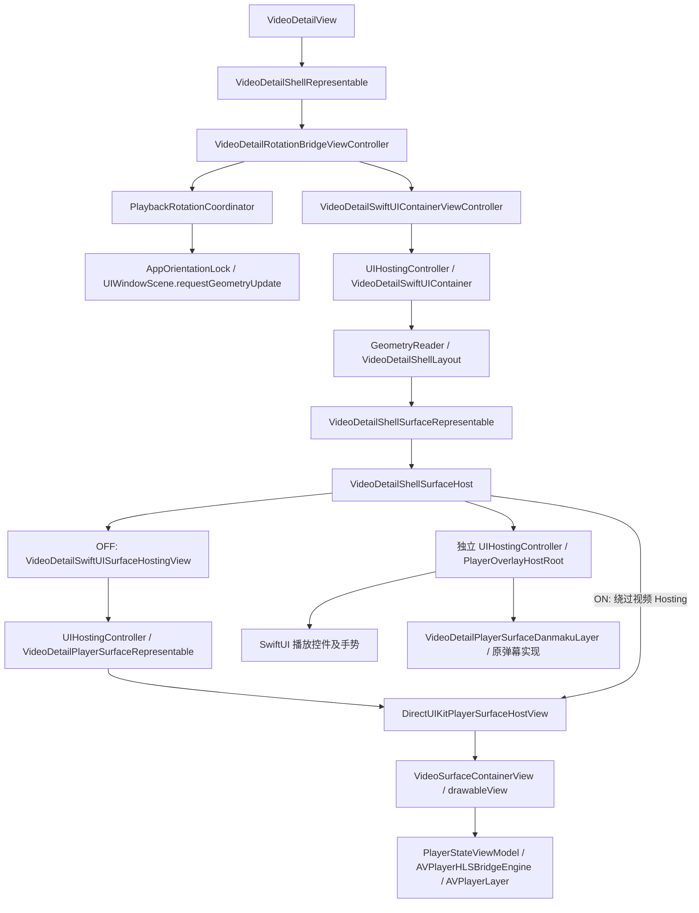

# 视频层与旋转稳定性实验

本次实现阶段 A（视频 Surface 直连）及阶段 B 的一项局部同步修正。默认关闭，未达到完整真机验收标准。部署版本仍为 iOS 26.1，使用 Xcode 27.1（27A9269）。

## 当前实际调用关系

`PlayerSurfaceController` 是仓库内另一套宿主协调入口，但当前详情页的上述 SwiftUI Container 路径不经过它；不修改该协调器。

## 发现与修改

- 原视频层虽然最终使用 DirectUIKitPlayerSurfaceHostView，仍嵌套了一层仅承载视频的 UIHostingController 和 UIViewRepresentable。实验开启后直接复用现有 UIKit host，独立控件／弹幕 Hosting 保留。
- VideoSurfaceContainerView 原本在 drawable 尺寸更新后用 Task.yield 延后刷新 AVPlayerLayer。测试证实普通布局调用完成时旧尺寸仍可能存在。实验路径改为同一 layoutSubviews 内刷新；旧路径及其他播放器调用默认仍为异步。
- 外层 representable 已对输入去重并合并异步配置，GeometryReader 的布局写回也已合并。没有证据支持重构这些流程，保持原样。
- 保留现有性能面板内容（其 UIKit 视频层标志原本就为 true，两条路径最终均使用 UIKit Surface）；通过 DEBUG 创建 signpost 和测试子控制器计数区分是否绕过视频 Hosting，避免改变任何现有可见诊断 UI。
- 保留旋转预热、保护性重复刷新、旋转完成 settle delay、额外 34ms 等待、watchdog、恢复策略和状态提交顺序。

新增 `LibraryStore.videoDetailUIKitSurfaceRotationExperimentEnabled`，入口为「开发者与诊断 → 实验开关 → UIKit 视频层与旋转稳定性优化」。默认 false，持久化。宿主模式在创建时确定，下次打开详情页生效；不在活动播放或 PiP 中迁移 Surface，不要求重新登录或重启 App。

## 测量方法与结果

在同一 iOS 27 Simulator（cilicili-iOS27-Codex）上，使用测试生成的同一段本地 H.264 MOV、无网络依赖，交替修改 Surface 宿主为 402×226 和 874×402，共 20 轮／40 次。检查真实 AVPlayerLayer、AVPlayer、AVPlayerItem、Surface。**这是组件几何测试，不是 UIWindowScene 系统旋转动画测试，也不是 HLS 网络播放测试。**

阶段 A 对照（准备完成，暂停状态）：

| 指标 | 原 Hosting 路径 | 直连路径，未同步 bounds |
|---|---:|---:|
| 普通 layoutIfNeeded 后图层尺寸立即正确 | 0/40 | 0/40 |
| 显式 refreshLayoutImmediately 后立即正确 | 0/40 | 40/40 |
| 视频层子 Hosting Controller | 1 | 0 |
| 尺寸切换新增 Surface attach/detach | 0/0 | 0/0 |

阶段 B 对照（准备完成，暂停状态，单次样本）：

| 指标 | OFF | ON |
|---|---:|---:|
| 普通 layoutIfNeeded 后图层尺寸立即正确 | 0/40 | 40/40 |
| 40 次同步布局调用累计耗时 | 16.973ms | 11.765ms |
| AVPlayer／AVPlayerItem／Surface 身份 | 均稳定 | 均稳定 |
| 尺寸切换新增 Surface attach/detach | 0/0 | 0/0 |
| 最终 surface／drawable／layer 尺寸及 resizeAspect | 正确 | 正确 |

累计耗时仅是 DEBUG 下组件同步调用的墙钟耗时，包含布局和诊断开销；单次样本不能证明真机整体旋转性能提升。可靠改善是少一层 Hosting，以及图层尺寸在同一布局调用内同步。

最终测试另加入本地播放、Seek 和暂停。旧路径需要有限等待以允许异步布局完成；实验路径仍要求 40/40 同步正确。测量文本保留在 xcresult 的 `Surface probe direct=false/true` 附件。

以下指标均为 **unavailable**：系统旋转总耗时、首个正确显示帧耗时、可见黑帧／音频中断、完整旋转主线程 CPU、SwiftUI body 刷新次数、弹幕动画连续性、控件恢复耗时。现有 DEBUG 旋转诊断和 signpost 保留，新增 DEBUG-only `VideoDetailSynchronousBoundsRefresh` 标记；没有新增 Release 日志或统计任务。

## UI 与生命周期验收范围

- 未改变 VideoDetailShellLayout、Safe Area、frame/position/zIndex 规则、视频 gravity、控件／弹幕树、滚动收缩、Toolbar、Liquid Glass、导航和手势实现。
- 原有布局测试覆盖竖屏、横屏、收缩、暂停、窗口坐标与 Safe Area、弹幕画布保留；均通过。
- 实际 VideoDetailShellSurfaceHost 组件测试确认 OFF 为两个子控制器，ON 为一个；三种尺寸下 overlay bounds 相同且控制器 identity 不变。
- 同一播放器重复绑定不迁移 Surface；播放器替换原位复用 Surface；重复 tearDown 安全；外壳退出后可释放、子控制器移除。
- **完整详情页截图前后对比未完成**，不能仅凭这些测试宣称完整视觉验收通过。

修改前运行两项现有真实详情页 UI 测试即失败：`testVideoDetailRapidRotationPublishesStableIdentityDiagnostics`（全屏按钮未出现）及 `testVideoDetailUsesLayeredPagesAndToolbarPicker`（相关推荐等待失败）。失败附件显示页面处于加载状态；本轮没有可靠定位加载失败的原因。基线已有 “Publishing changes from within view updates” 运行时警告，未在本次小范围 Surface 改动中擅自修改其他状态流程。

尚未完成：真机 20 轮系统旋转、左右横屏快速切换、真实 Seek／画质切换／弹幕交互、旋转中退出和后台恢复、PiP 进入／返回、堆叠详情页返回、收缩后全屏的完整端到端验证，以及 Instruments 内存与 CPU 采样。不得将本地组件测试视为这些场景已通过。

## 主要文件

- LibraryStore.swift、MineDeveloperDiagnosticsView.swift：实验开关。
- VideoDetailShellSurfaceHost.swift、VideoDetailPlayerSurfaceRepresentable.swift：宿主选择。
- DirectUIKitPlayerSurfaceHostView.swift、VideoSurfaceView.swift：实验专用 bounds 同步。
- VideoDetailSurfaceHostTests.swift：默认关闭／持久化、双路径对照、重绑／释放、控件宿主稳定性。

保留原 AVPlayer 引擎、HLS Bridge、PiP、画质切换和缓冲策略；未引入依赖或私有 API。用户原有 SkeletonBlocks、评论标题／初始评论区及未跟踪分析文档不纳入提交。

## 最终验证记录

- Debug build：Xcode 27.1，scheme `bili`，destination `cilicili-iOS27-Codex`（iOS 27 Simulator），成功。
- 相关 XCTest：55/55 PASS，无本次新增 warning/error。增量构建无 warning；初次完整构建保留仓库既有并发等 warning，未做无关修复。
- 最终播放／Seek／暂停混合对照：OFF/ON 普通布局即时正确分别为 0/40 与 40/40；同步调用累计耗时分别为 34.286ms 与 11.583ms。该数字仍仅为单轮 DEBUG 组件测量；不以此宣称整体旋转速度提升。
- 结果：`test_sim_2026-10-08T17-05-36-568Z_pid116_0c43aec6.xcresult`；测量附件另导出到 `build/VideoDetailRotationValidation/UnitAttachments`（不纳入 Git）。
- 两项原真实详情页 UI 基线失败明确保留，不计入上述 55 项 PASS。完整视觉／真机验收仍未通过。

## 2026-10-09 后续完善

- 每次旋转增加递增序号，并分别记录 UIKit 系统转场结束耗时、Surface 与控件宿主的首个正确几何节点、弹幕画布尺寸配置节点，以及完成时系统实际方向。播放器、PlayerItem、Surface 的身份变化次数单独记录；页面首次播放／首帧耗时仍保留为页面级指标。
- 黑帧诊断现在会区分“起始帧已正常，旋转期间未测量”“无可用帧快照”“从黑帧开始监测”“已观察到恢复”和“监测未完成”。它仍是 DEBUG 的帧图像启发式检测，不能替代屏幕录制来判断用户可见黑帧。
- 实验开启时，Surface bounds 同步刷新会取消同一绑定上等待执行的 Task.yield 延迟刷新，避免两次刷新同一几何。未启用同步刷新时仍走既有延迟路径；强制刷新入口和旋转等待、watchdog、恢复时序保持原样。
- 预热使用可取消的 DispatchWorkItem，执行时校验当前播放器、宿主和代次；更换播放器／宿主或拆卸页面会使旧任务失效。实验直连路径在旋转开始时取消尚未执行的预热，避免延迟任务插入系统转场。
- 新增诊断阶段与身份变化测试，并新增同步布局取消重复延迟刷新的测试。Xcode 27.1、scheme bili、iOS 27 Simulator：12/12 项相关测试通过，最终 Debug build 成功；未修改文件没有引入 warning。
- 本轮没有修改系统旋转等待时序。Simulator 测试仍不代表真机系统旋转、真实显示帧连续性、音频或 PiP 已验收。
